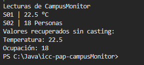

1. Implementación realizada

Qué representa la clase Lectura< T >.

La clase lectura< T > representa un dato generico que puede guardar cualquier tipo de dato , en este caso de lectura guarda el codigo, el valor y la unidad 

Qué representa T y por qué permite utilizar la misma clase para temperatura y ocupación.

Representa un dato generico que es como una caja que avisa a java que ahi irá cualquier tipo de dato que decida guardar. Y se permite utilizar la misma clase ya que la clase acepta cualquier tipo de dato, en este caso en la temperatura la T toma un Double para poder guardar los decimales, y para la oucpacion T toma la forma de Integer para poder guardar los numeros enteros, asi nos evinamos tener que crear clases separadas para cada sensor   

Qué agregaste en App.java.

En app primero se creo el metodo runLectura y dentro de el se instancio la clase Lectura.java para crear los objetos 
Los objetos que se crearon son de tipo lectura, el uno la temperatura y el otro la ocupacion. Despues se agrego los respectivos sout para imprimir en la terminal los datos de los sesores usando los metodos ya creados de get valor  

Salida de consola: 

No necesitamos hacer un casting ya que al usar los datos genericos de tipo < T > java ya sabe cual sera el tipo de dato que vamos a guardar al momento que creamos el objeto, es decir en en el caso de temperatura se usa un Double, aqui java ya sabe que tipo de dato es por lo que no es necesario hacer un casting, en el metodo getValor devuelve el tipo de dato original, asi nos permite poder guardarlo en la variable que es.