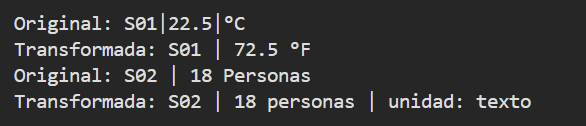
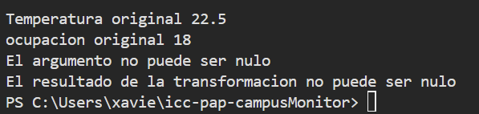

Salida de Consola : 

Excepciones de conversion : 

En un párrafo breve, explica qué representa R y por qué transformar es genérico aunque runTransformaciones no lo sea. Indica qué agregaste en Lectura y App: 

El dato generico R es el tipo de dato que tendra el valor despues de haberlo transformado.
El metodo transformar es generico porque este puede transformar un dato T a otro tipo R mientras que runTransformaciones no es generico porque solo ejecuta las transformaciones.
En la clase Lectura agregue el metodo transformar de tipo generico R que recibe una funcion y una nueva unidad 
Despues se incluye una validación con un ⁠if⁠ para verificar que el conversor no sea nulo y dando una exepcion si lo es, despues se aplica el valor actual a la función conversor y se valida que el resultado no sea nulo y se retorna una nueva instancia de ⁠Lectura⁠ con el nuevo valor transformado y la nueva unidad

En app se agrego el metodo runTransformaciones usando los mismos datos anteriores pero agregando la diferencia de transformar Celsius a Farenheit con la formula matematica y de un numero a texto ademas de las tres pruebas para los tres casos validos de excepciones 

Comprobe que los valores originales quedan iguales al ejecutar las transformaciones, la temperatura sigue siendo 22.5 °C y la ocupacion sigue siendo 18 personas
Tambien vi que el resultado puede tener otro tipo de dato ya que la temperatura continua siendo un Double y la ocupacion se transforma de Integer a un String sin tener que utilizar casting.

